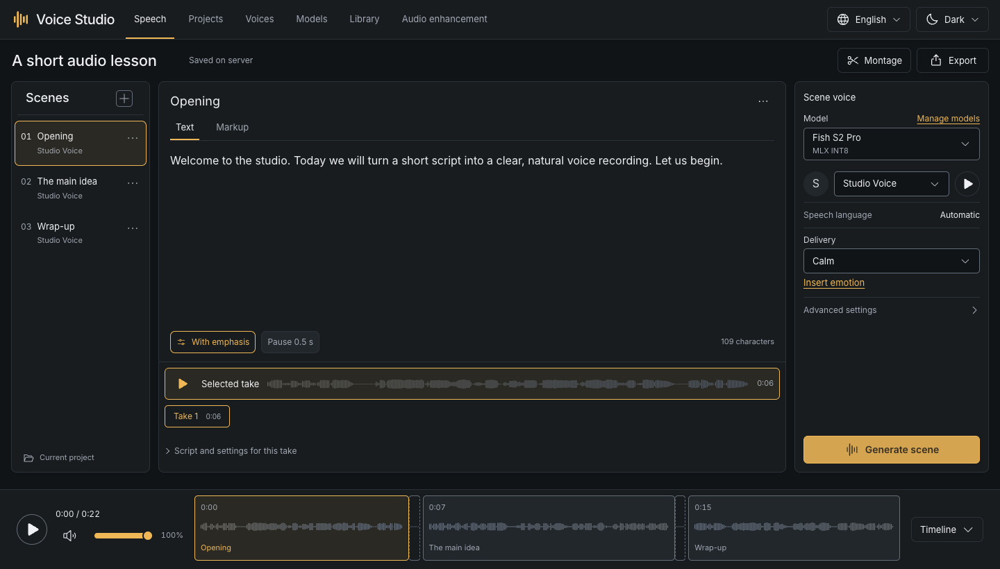
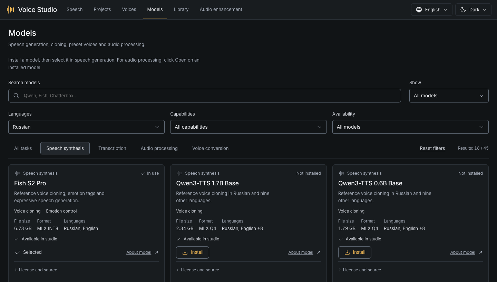
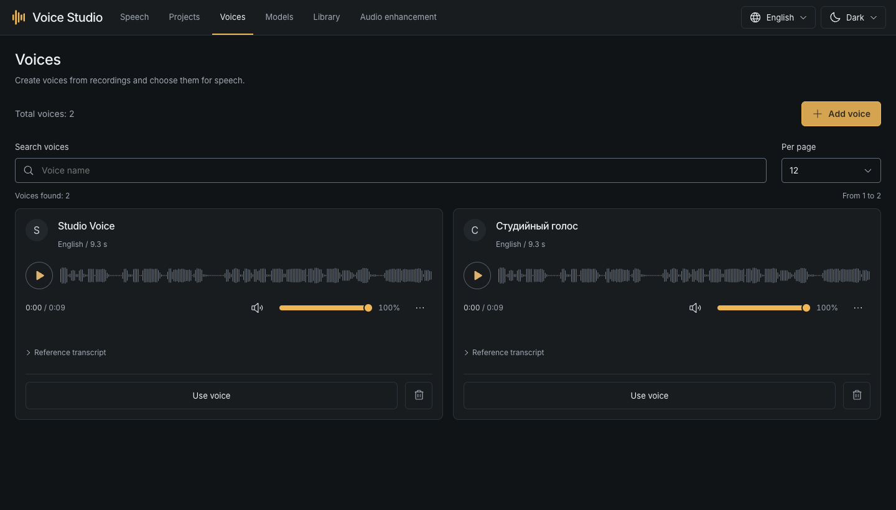
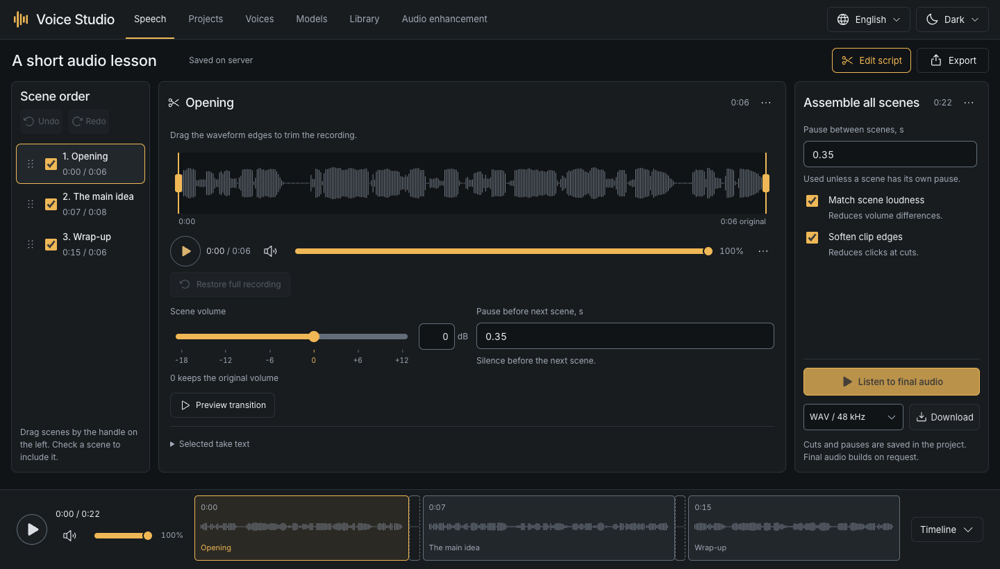
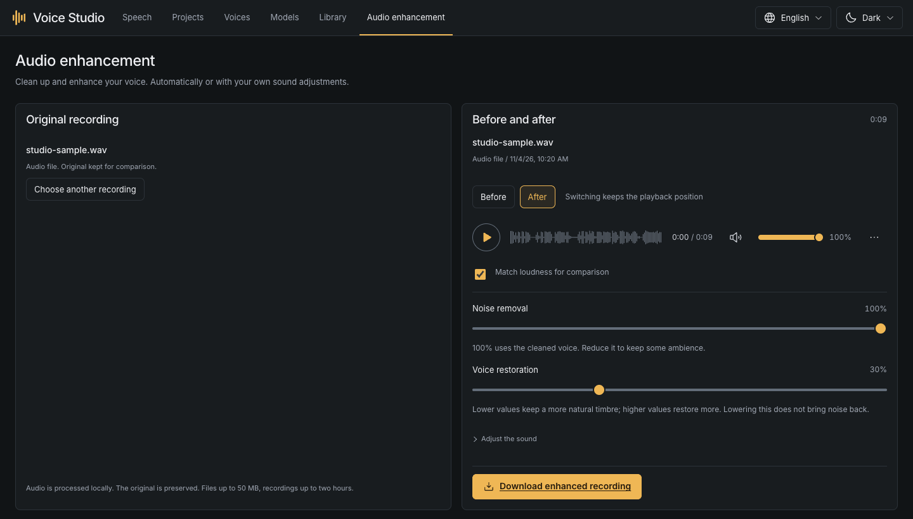
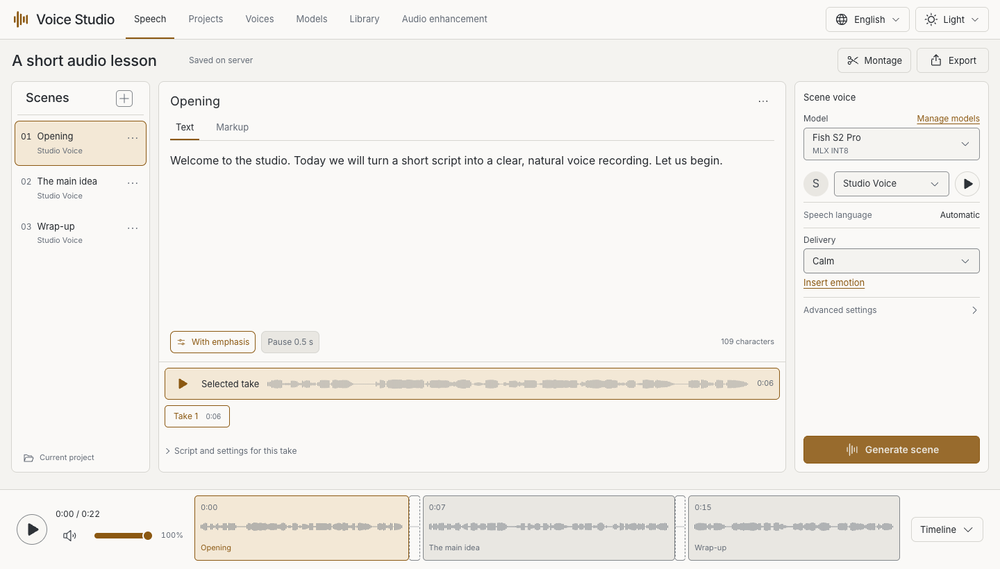

# Voice Studio

**Local text-to-speech, voice cloning and audio enhancement for your Mac.**

[](docs/status.md)
[](docs/setup.md)
[](LICENSE)
[](https://github.com/Evgenykravchenko/voice-studio/actions/workflows/ci.yml)

**English** · [Русский](README.ru.md)

[Website](https://evgenykravchenko.github.io/voice-studio/) · [Get started](#get-started) · [Screenshots](#screenshots) · [Models](docs/models.md) · [Help](docs/troubleshooting.md) · [Roadmap](docs/roadmap.md)



Voice Studio is an open-source local text-to-speech (TTS) application.
Create narration for lessons, videos and podcasts in a browser-based studio.
Generate takes, assemble scenes and improve recordings on your own computer.
Choose from 45 downloadable models for speech and audio tasks; install only
what you need. Inference runs locally after setup and model downloads.

The interface is available in English and Russian, with light and dark themes.
Java and Python run the local backend; the launcher sets up the required tools.

> [!NOTE]
> **Beta for macOS 14+ on Apple Silicon.** Windows and Linux support is planned.
> Speech quality, supported languages and memory requirements vary by model.

## What you can do

| Task | In the studio |
| --- | --- |
| Generate speech | Choose a cloned, built-in or described voice. |
| Create voices | Upload a sample, review its transcript and save a reusable profile. |
| Assemble audio | Reorder scenes, select takes, trim edges, add pauses and export. |
| Improve recordings | Upload a file or record with a microphone; compare before and after. |
| Manage models | Browse 45 entries; filter, download, cancel and resume installations. |
| Keep your work | Projects, takes, voice profiles and processing history stay on disk. |

Speech models include **Fish S2 Pro, Qwen3-TTS, Chatterbox, CosyVoice 3, VoxCPM2,
Kokoro, Piper and Silero**. Whisper and GigaAM transcribe reference recordings;
Resemble Enhance improves existing audio. See the [complete model catalog](https://evgenykravchenko.github.io/voice-studio/models/)
for every integration, voice mode, model file size and license.

## Get started

### 1. Launch

Download the repository with **Code → Download ZIP** and unzip it. Open the
extracted folder in Terminal: in Finder, right-click the folder and use
**New Terminal at Folder** under Services.

```sh
./scripts/studio.sh
```

The first launch installs local tools and dependencies, then builds the app.
You do not need to install Java, Python, Node.js or Homebrew yourself.
Keep Terminal open, wait for setup to finish, and open
**[127.0.0.1:4173](http://127.0.0.1:4173)**.

Internet is needed for setup and model downloads. Installed models run offline.
[Requirements and setup details →](docs/setup.md)

### 2. Install your first model

Open **Models** and choose a starting point:

| Your task | Install |
| --- | --- |
| Clone a voice and generate speech | **Fish S2 Pro** and **Whisper Small**. |
| Try a ready-made Russian voice | A **Piper** voice; no recording is needed. |
| Clean up an existing recording | **Resemble Enhance**. |

Wait until the model is ready. Installation also prepares its required codecs,
dictionaries and isolated dependencies. You do not need the whole catalog.
Check card sizes before downloading: weights and dependencies can take gigabytes.



### 3. Create a recording

For cloning, open **Voices → Add voice**. Upload one speaker's clear recording,
choose a 10-30 second excerpt, review its transcript and save. This creates a
reference profile; it does not retrain the model.

Open **Speech**, enter your text, choose the model and voice, and click
**Generate scene**. Listen to the take or open **Montage** to combine scenes.
For built-in voices, choose a speaker directly in Speech.
[The complete workflow →](docs/guide.md)

## Screenshots

<details>
<summary>Explore voices, scene editing, audio enhancement and the light theme</summary>

### Reusable voice profiles



### Scene editing



### Audio enhancement



### Light theme



</details>

## Guides

| Guide | What it answers |
| --- | --- |
| [Setup](docs/setup.md) | Requirements, first launch, starting and stopping. |
| [Using the studio](docs/guide.md) | Voices, takes, montage, cleanup and other tools. |
| [Models and delivery](docs/models.md) | Model choices, languages, emotions and memory. |
| [Your data and updates](docs/storage.md) | Saving, backups, moving, updating and uninstalling. |
| [Troubleshooting](docs/troubleshooting.md) | Downloads, missing voices, pronunciation and memory. |
| [Development and CLI](docs/development.md) | Architecture, local checks and command-line use. |

## Privacy and license

Recordings and scripts are processed locally. Personal profiles, projects,
generated audio and model weights are excluded from the repository. Screenshots
use example projects and a synthetic reference voice.

The app code is [MIT licensed](LICENSE). Models and third-party components have
their own terms: see their cards and [third-party notices](THIRD_PARTY_NOTICES.md).
[Release status](docs/status.md) documents tested behavior and known limitations.
[Security policy](SECURITY.md) · [Contribution and commit rules](CONTRIBUTING.md) · [Release process](docs/releasing.md)

## Feedback and contributions

Ask questions and share model or workflow feedback in [Discussions](https://github.com/Evgenykravchenko/voice-studio/discussions).
Found a bug or have a concrete feature request? [Open an issue](https://github.com/Evgenykravchenko/voice-studio/issues/new/choose).
English and Russian are welcome. Read [Contributing](CONTRIBUTING.md) for code and documentation changes.

See the [roadmap](docs/roadmap.md) for planned work. If the studio is useful to you,
consider giving the repository a star or sharing it with someone who works with audio.
