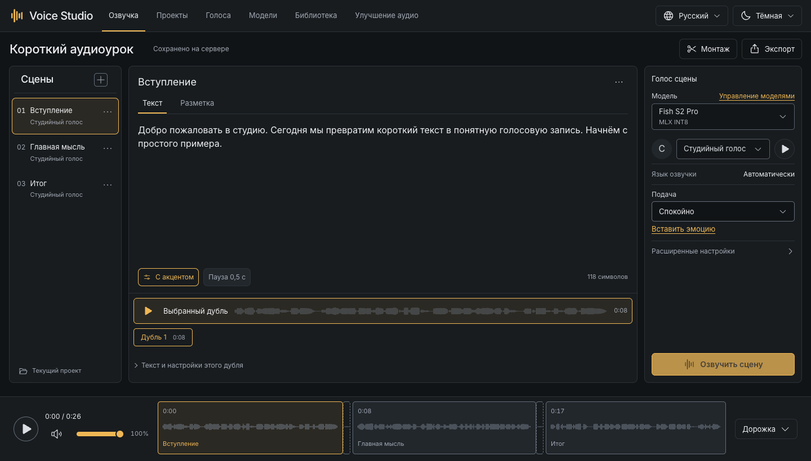
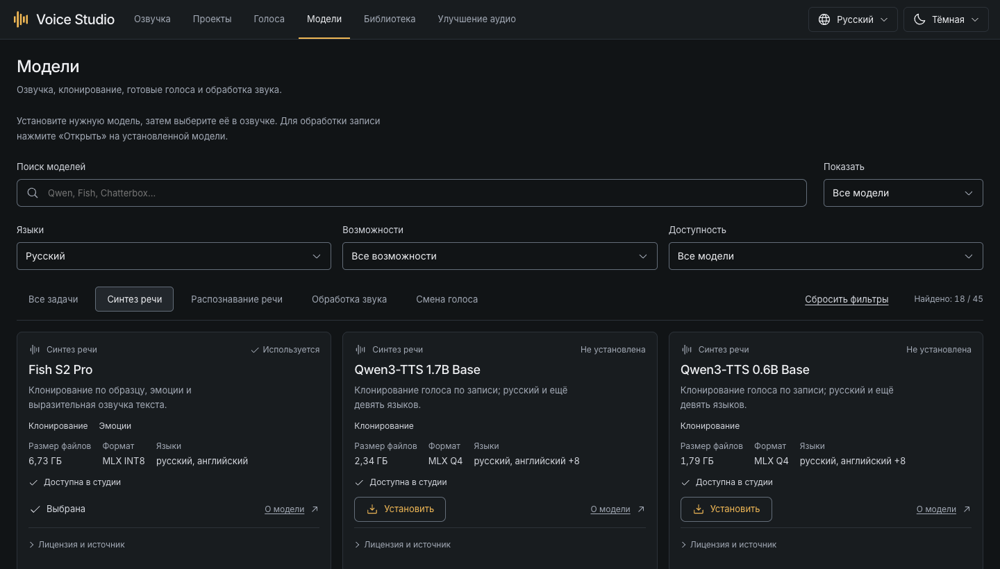
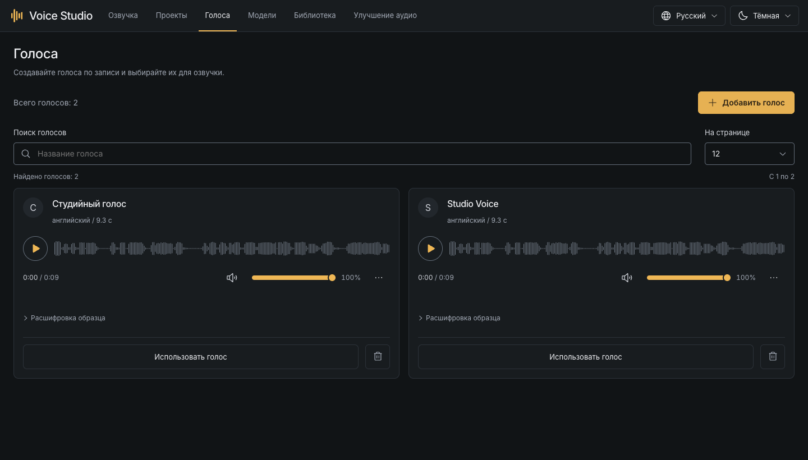
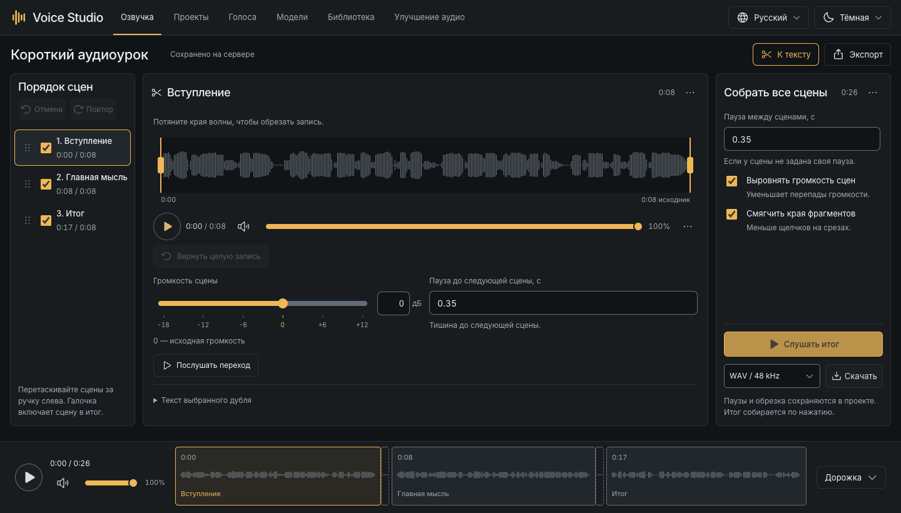
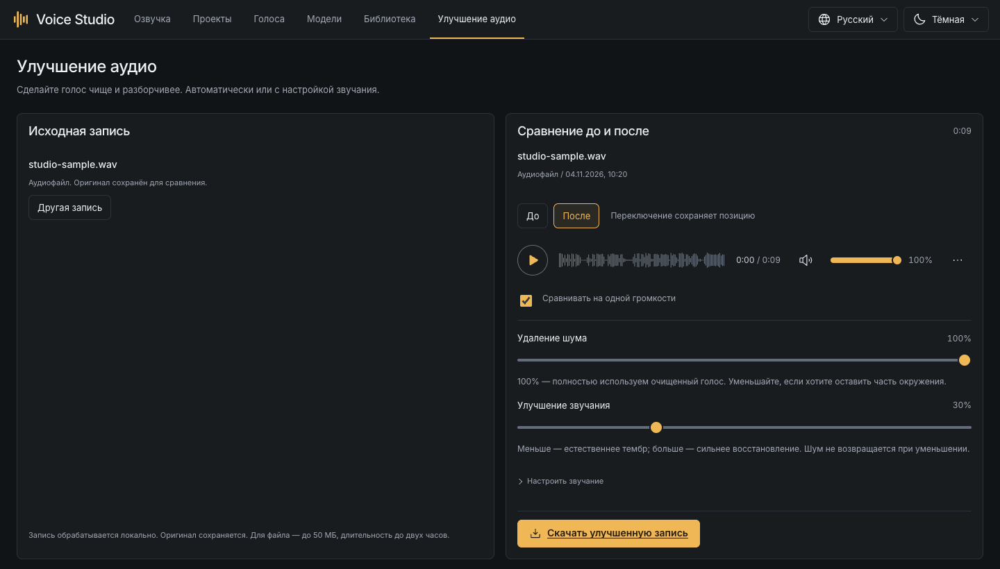
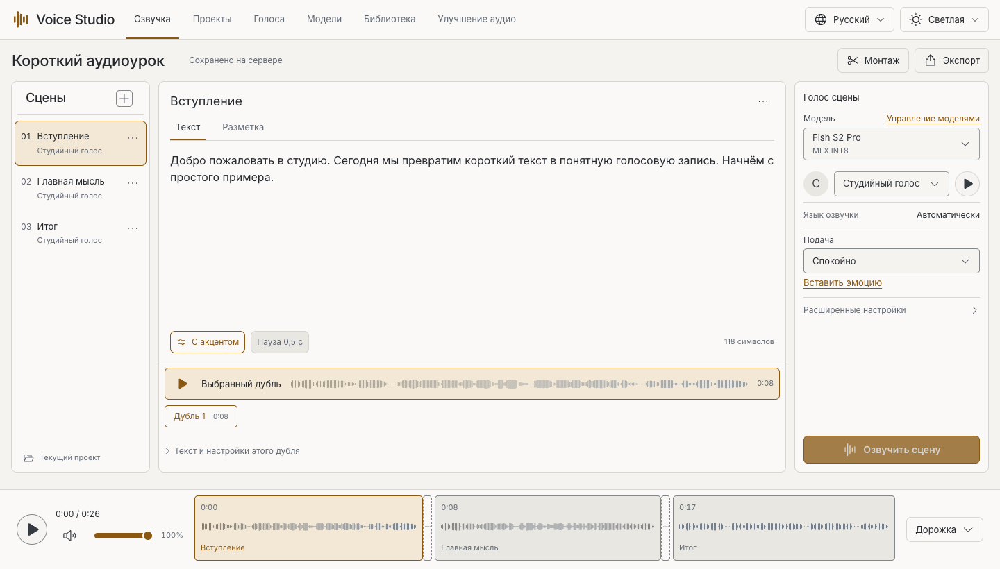

# Voice Studio

**Озвучка текста, клонирование голоса и улучшение записей на вашем Mac.**

[](docs/status.ru.md)
[](docs/setup.ru.md)
[](LICENSE)
[](https://github.com/Evgenykravchenko/voice-studio/actions/workflows/ci.yml)

[English](README.md) · **Русский**

[Сайт проекта](https://evgenykravchenko.github.io/voice-studio/ru/) · [Быстрый старт](#быстрый-старт) · [Скриншоты](#скриншоты) · [Модели](docs/models.ru.md) · [Помощь](docs/troubleshooting.ru.md) · [Планы](docs/roadmap.ru.md)



Voice Studio создаёт речь из текста (TTS) локально и имеет открытый исходный код.
Создавайте озвучку уроков, видео и подкастов в браузере. Генерируйте дубли,
собирайте сцены и улучшайте записи на своём компьютере. В каталоге 45 моделей
для речи и обработки аудио; скачивайте только нужные. После установки
и загрузки моделей обработка работает локально.

Есть русский и английский интерфейс, светлая и тёмная темы.
Java и Python обеспечивают работу сервера; скрипт запуска устанавливает нужные инструменты.

> [!NOTE]
> **Версия 0.1.1 для macOS 14+ на Apple Silicon.** Windows и Linux запланированы.
> Качество речи, доступные языки и расход памяти зависят от модели.

## Возможности

| Задача | Что доступно в студии |
| --- | --- |
| Озвучка текста | Клонированный, готовый или созданный по описанию голос. |
| Создание голосов | Загрузка образца, проверка расшифровки и сохранение профиля. |
| Сборка аудио | Порядок сцен, выбор дублей, обрезка краёв, паузы и экспорт. |
| Улучшение записей | Загрузка файла или запись с микрофона, сравнение до и после. |
| Управление моделями | Каталог из 45 записей, фильтры, скачивание, отмена и продолжение. |
| Сохранение работы | Проекты, дубли, голоса и история обработки хранятся на диске. |

Для озвучки доступны **Fish S2 Pro, Qwen3-TTS, Chatterbox, CosyVoice 3, VoxCPM2,
Kokoro, Piper и Silero**. Whisper и GigaAM расшифровывают образцы голоса,
Resemble Enhance улучшает готовое аудио. Все интеграции, режимы голоса, размеры
файлов и лицензии собраны в [открытом каталоге моделей](https://evgenykravchenko.github.io/voice-studio/ru/models/).

## Быстрый старт

### 1. Запустите приложение

Скачайте репозиторий через **Code → Download ZIP** и распакуйте его.
Откройте папку в Терминале: в Finder нажмите на неё правой кнопкой мыши
и выберите **«Новый терминал по адресу папки»** в разделе служб.

```sh
./scripts/studio.sh
```

Первый запуск установит локальные инструменты и зависимости, затем соберёт
приложение. Отдельно устанавливать Java, Python, Node.js или Homebrew не нужно.
Оставьте Терминал открытым, дождитесь завершения установки и откройте
**[127.0.0.1:4173](http://127.0.0.1:4173)**.

Для установки и скачивания моделей нужен интернет. После установки генерация
работает офлайн. [Требования и подробности установки →](docs/setup.ru.md)

### 2. Установите первую модель

Откройте **«Модели»** и выберите первый набор:

| Задача | Что установить |
| --- | --- |
| Клонировать голос и озвучивать текст | **Fish S2 Pro** и **Whisper Small**. |
| Попробовать готовый русский голос | Один из голосов **Piper**, собственная запись не нужна. |
| Улучшить существующую запись | **Resemble Enhance**. |

Дождитесь готовности модели. Установка включает нужные кодеки, словари и
отдельные зависимости. Скачивать весь каталог не требуется. Проверьте размеры
в карточках: модели и зависимости могут занимать несколько гигабайтов.



### 3. Создайте озвучку

Для клонирования откройте **«Голоса → Добавить голос»**. Загрузите чистую запись
одного человека, выберите фрагмент на 10-30 секунд, проверьте расшифровку
и сохраните. Это профиль с образцом голоса, а не переобучение модели.

Откройте **«Озвучка»**, введите текст, выберите модель и голос, затем нажмите
**«Озвучить сцену»**. Прослушайте дубль или перейдите в **«Монтаж»** для сборки сцен.
В модели с готовыми голосами достаточно выбрать диктора прямо в озвучке.
[Все шаги работы →](docs/guide.ru.md)

## Скриншоты

<details>
<summary>Голоса, монтаж, улучшение записей и светлая тема</summary>

### Профили голосов



### Монтаж сцен



### Улучшение аудио



### Светлая тема



</details>

## Руководства

| Раздел | Какие вопросы решает |
| --- | --- |
| [Установка](docs/setup.ru.md) | Требования, первый запуск, включение и остановка. |
| [Работа в студии](docs/guide.ru.md) | Голоса, дубли, монтаж, очистка и другие инструменты. |
| [Модели и подача](docs/models.ru.md) | Выбор модели, языки, эмоции и память. |
| [Данные и обновления](docs/storage.ru.md) | Сохранение, резервные копии, перенос, обновление и удаление. |
| [Решение проблем](docs/troubleshooting.ru.md) | Скачивание, недоступные голоса, произношение и память. |
| [Разработка и CLI](docs/development.ru.md) | Устройство проекта, проверки и командная строка. |

## Приватность и лицензия

Записи и тексты обрабатываются локально. Личные профили, проекты, готовые записи
и веса моделей исключены из репозитория. На скриншотах показаны примеры проектов
и голос с синтетическим эталоном.

Код приложения распространяется по [MIT](LICENSE). У моделей и сторонних
компонентов свои условия: смотрите карточки и [список лицензий](THIRD_PARTY_NOTICES.md).
Проверки и оставшиеся ограничения описаны в [состоянии выпуска](docs/status.ru.md).
[Политика безопасности](SECURITY.ru.md) · [Участие и правила коммитов](CONTRIBUTING.ru.md) · [Порядок релизов](docs/releasing.ru.md)

## Обратная связь и участие

Вопросы, опыт работы с моделями и примеры сценариев можно обсудить в [Discussions](https://github.com/Evgenykravchenko/voice-studio/discussions).
Нашли ошибку или хотите предложить конкретную функцию? [Создайте issue](https://github.com/Evgenykravchenko/voice-studio/issues/new/choose).
Можно писать на русском и английском. Для изменений кода и документации есть [руководство участника](CONTRIBUTING.ru.md).

Дальнейшие задачи собраны в [планах развития](docs/roadmap.ru.md). Если студия оказалась полезной,
поддержите репозиторий звездой или расскажите о нём тем, кто работает со звуком.

[История изменений](CHANGELOG.ru.md) · [Разбор безопасности 0.1.0](docs/security-review.ru.md)
