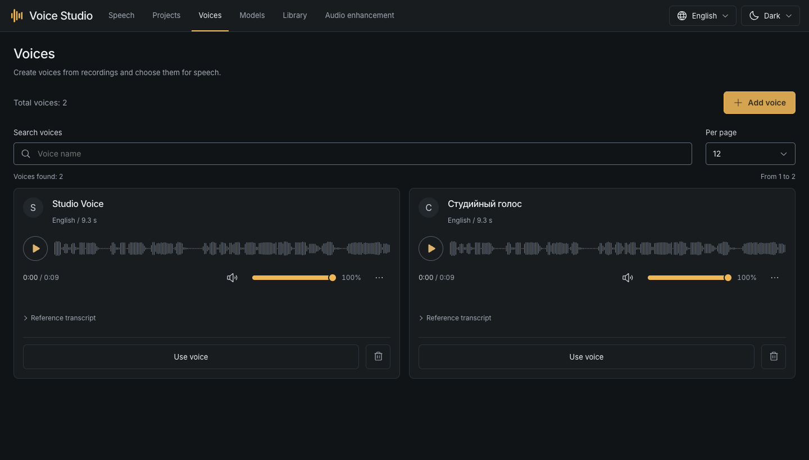
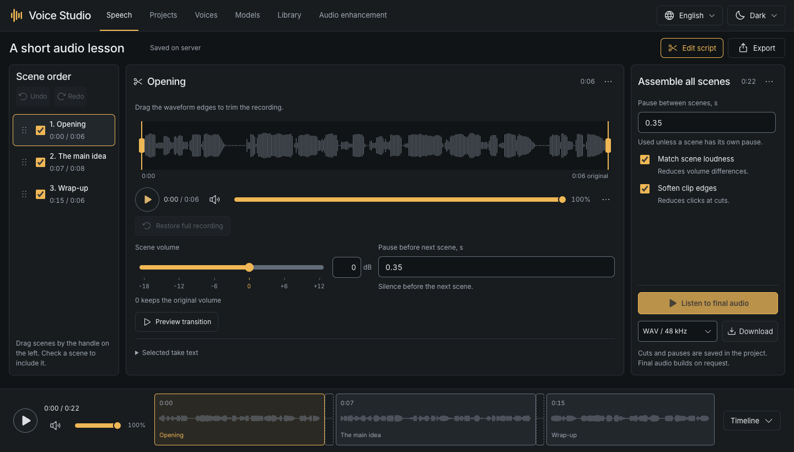
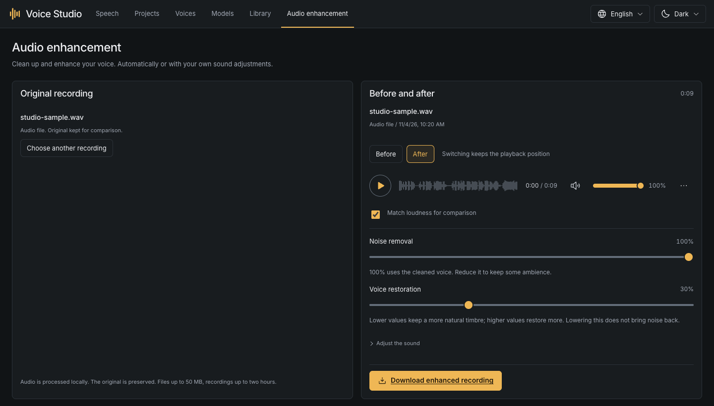
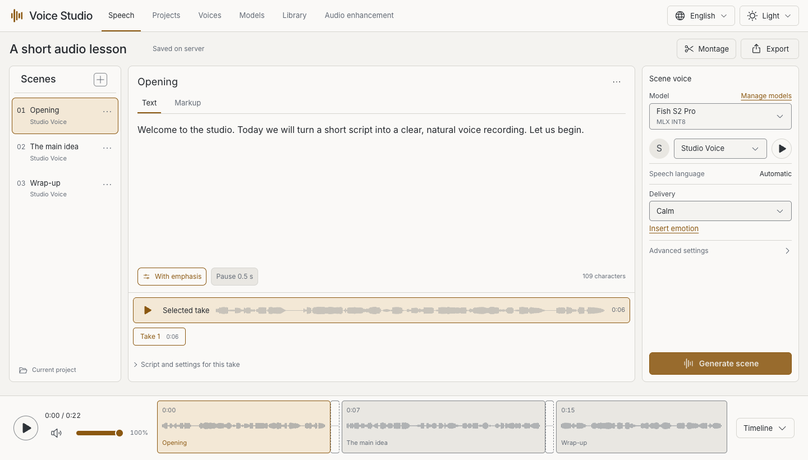

# Using the studio

**English** · [Русский](guide.ru.md) · [Home](../README.md)

[Voices](#create-a-voice) · [Speech](#generate-speech) · [Montage](#assemble-the-final-recording) · [Cleanup](#improve-a-recording)

## Create a voice

Install a speech-recognition (ASR) model such as Whisper Small in Models. It writes the sample's
transcript; your speech-synthesis model produces the new recording later.

1. Open **Voices → Add voice** and give the profile a name, such as “Narrator”.
2. Upload a recording of one speaker: no background music, strong echo or overlapping voices.
3. Choose the start and excerpt length. **10–30 seconds** is a useful starting point; the allowed range is 5–30 seconds.
4. Choose the recording's language and prepare the voice.
5. Listen to the excerpt. Correct its transcript to match every spoken word, then save.

Uploads support WAV, MP3, M4A, FLAC, OGG, AAC, AIFF, Opus and WebM, up to **50 MB**.
The original stays intact. A profile stores the prepared sample and transcript;
no weight training is required. Use a voice you own or have permission to use.



Search the catalog, preview a voice, or use it in the current scene. Deleting a
profile asks for confirmation and preserves completed takes. A scene using that
deleted profile needs another voice for its next generation.

## Generate speech

Open or create a project in **Projects**, then work in **Speech**.

1. Add a scene and enter its script: up to **3,000 characters per scene**.
2. Choose an installed model and a voice. Built-in and described-voice modes do not require a saved profile.
3. Set the speech language when the model offers it. “Automatic” uses the text.
4. Choose a supported delivery and click **Generate scene**.
5. Listen, seek by clicking the waveform, and keep the take you prefer.

Each generation creates a take with its own script and settings. Editing the
script does not rewrite an existing recording. Choose a different take to use
it in the final mix. Download an individual take to keep its original audio.

For an explicit pause in ordinary text:

```text
Welcome to the studio. [pause:0.5] Let us begin.
```

Emotion tags differ by model. Use the editor's hint and [model guide](models.md#delivery-and-pauses)
instead of copying tags between families. Start with plain text for your first test.

## Assemble the final recording

Open **Montage** beside Export. All edits are non-destructive.



- Drag the scene handles to change order. Uncheck a scene to leave it out of the mix.
- Choose the desired take, then drag the waveform edges to trim. **Restore full recording** resets the cut.
- Set a default gap or a separate pause before the next scene. There is no trailing scene gap at the end.
- **Scene volume** changes that scene's level in previews and the mix. Zero dB keeps its original level; player volume only changes listening.
- Preview a transition to check the join. Optional leveling balances scene levels; soft edges reduce clicks.
- Preview the complete mix, choose an available export format, and download.

The bottom timeline represents the final arrangement, including silence and cuts.
Changes to montage settings require a new render. Text edits alone do not change
previous takes. Header project export saves **JSON**, not a complete audio backup.

## Improve a recording

Install Resemble Enhance. Open **Audio enhancement** to upload a file or explicitly
record from a microphone. Pause, finish or cancel capture before processing;
the browser requests microphone permission only when you start recording.



Start with the automatic enhancement action, then compare the result:

- **Noise removal** controls background reduction.
- **Voice restoration** controls how much the cleaned voice is reconstructed. Lower it for a more natural result.
- Sound adjustments contain clarity, warmth, sibilance reduction, leveling and peak protection.

Before/After preserves your playback position. Loudness-matched comparison is for
listening only. After changing settings, update the result to hear the new version.
Save the download you prefer; the original and earlier versions remain available.
Strong enhancement can alter words or timbre. Always listen before using a result.

A scene's take menu can open enhancement for that take. Applying a result adds
a new take. Final-mix enhancement creates a separate result and does not overwrite scenes.
Microphone capture is limited to five minutes; uploaded files are limited to 50 MB
and processing to two hours.

## Other tools and appearance

In Models, OpenVoice converts a recording to a selected reference voice; MOSS
SoundEffect creates a sound from a description and duration. Install their models
first, then open the tool in the card. Conversion accepts up to 50 MB and three minutes.

Library contains generated takes and processing results, with search and downloads.
Project saving is automatic; wait for the saved status before closing the app.
The header changes interface language and theme. This never translates your script.

<details>
<summary>Light appearance</summary>



</details>

[Models and delivery](models.md) · [Saving and backups](storage.md) · [Help](troubleshooting.md)
