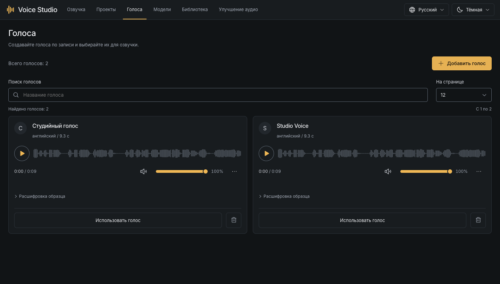
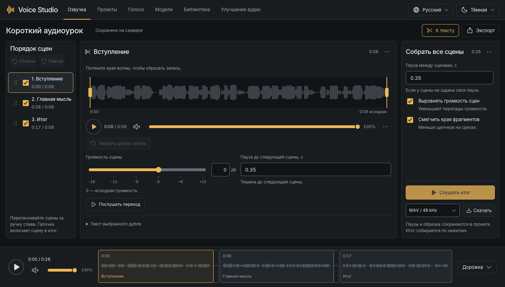
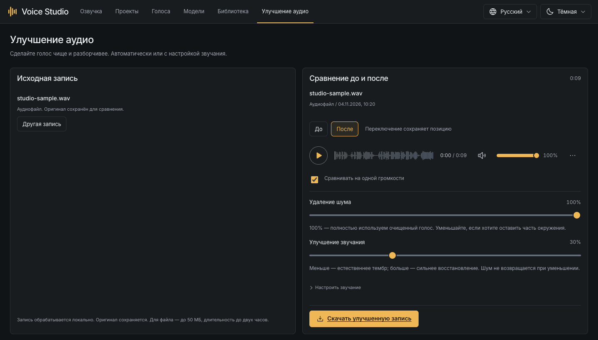
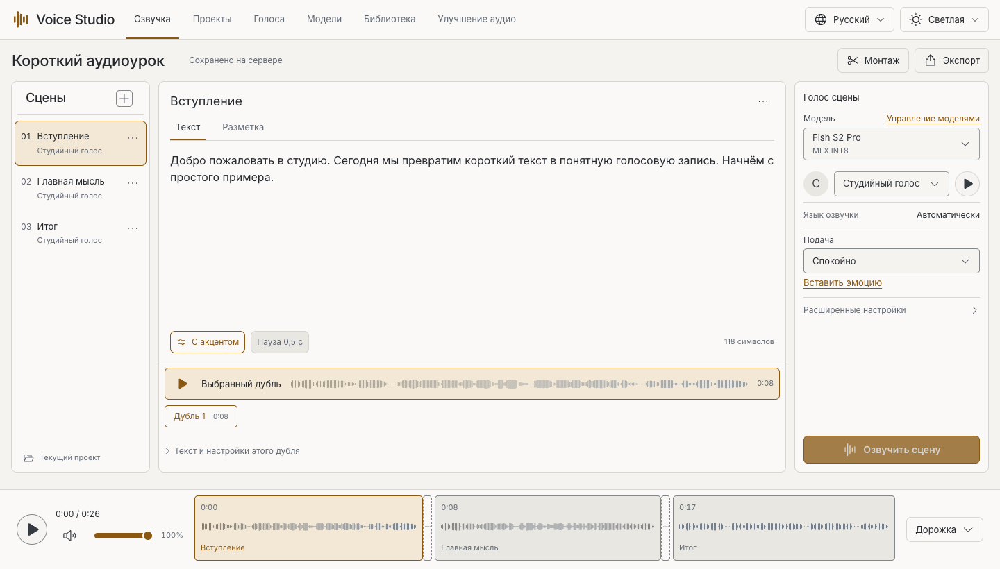

# Работа в студии

[English](guide.md) · **Русский** · [На главную](../README.ru.md)

[Голоса](#создание-голоса) · [Озвучка](#озвучка-текста) · [Монтаж](#сборка-итоговой-записи) · [Улучшение](#улучшение-записи)

## Создание голоса

Сначала установите модель распознавания, например Whisper Small, в «Моделях».
Она готовит расшифровку образца. Новую озвучку позже создаёт модель синтеза речи.

1. Откройте **«Голоса → Добавить голос»** и задайте имя, например «Рассказчик».
2. Загрузите запись одного человека без музыки, сильного эха и чужих голосов.
3. Выберите начало и длину фрагмента. Для начала удобно **10-30 секунд**; допустимо от 5 до 30.
4. Укажите язык записи и подготовьте голос.
5. Прослушайте фрагмент. Исправьте расшифровку так, чтобы она точно совпадала с речью, и сохраните.

Поддерживаются WAV, MP3, M4A, FLAC, OGG, AAC, AIFF, Opus и WebM до **50 МБ**.
Исходник сохраняется. Профиль хранит подготовленный образец и текст; обучение
весов не требуется. Используйте свой голос либо голос с разрешения его владельца.



Голоса можно искать, прослушивать и выбирать для текущей сцены. Удаление
запрашивает подтверждение и сохраняет готовые дубли. Для новой озвучки сцены
с удалённым профилем нужно выбрать другой голос.

## Озвучка текста

Откройте или создайте проект в **«Проектах»**, затем перейдите в **«Озвучку»**.

1. Добавьте сцену и введите текст: до **3 000 символов на сцену**.
2. Выберите установленную модель и голос. Для готового голоса или создания по описанию профиль не нужен.
3. Укажите язык озвучки, если модель предлагает выбор. «Автоматически» означает определение по тексту.
4. Выберите доступную подачу и нажмите **«Озвучить сцену»**.
5. Прослушайте результат, перематывайте кликом по волне и выберите удачный дубль.

Каждая генерация создаёт дубль со своим исходным текстом и настройками. Правки
текста не переписывают старую запись. Выбранный дубль используется в итоговой
дорожке. Скачивание отдельного дубля сохраняет его оригинальное аудио.

Явную паузу в обычном тексте можно задать так:

```text
Добро пожаловать в студию. [pause:0.5] Начнём.
```

У разных моделей разные теги эмоций. Смотрите подсказку редактора и
[руководство по моделям](models.ru.md#подача-и-паузы), а не переносите разметку
между семействами. Первый тест лучше сделать на обычном тексте.

## Сборка итоговой записи

Откройте **«Монтаж»** рядом с экспортом. Правки не уничтожают исходники.



- Перетаскивайте сцены за ручку слева. Снимите галочку, чтобы исключить сцену из итога.
- Выберите дубль и потяните края волны для обрезки. **«Вернуть целую запись»** сбрасывает обрезку.
- Задайте общую паузу либо отдельную паузу до следующей сцены. После последней сцены такая пауза не добавляется.
- **Громкость сцены** меняет её уровень в прослушивании и итоговом миксе. Ноль дБ сохраняет исходный уровень; громкость плеера влияет только на прослушивание.
- Проверьте переход. Выравнивание приближает громкость сцен друг к другу; мягкие края уменьшают щелчки.
- Прослушайте весь итог, выберите доступный формат и скачайте запись.

Нижняя дорожка соответствует итоговой сборке, включая тишину и обрезку.
После изменения монтажных настроек нужна новая сборка. Правки текста сами
по себе не меняют старые дубли. Экспорт проекта в шапке сохраняет **JSON**,
а не полноценную копию аудио.

## Улучшение записи

Установите Resemble Enhance. Откройте **«Улучшение аудио»**: загрузите файл либо
запишите речь с микрофона. Запись можно приостановить, закончить или отменить.
Разрешение на микрофон запрашивается только при явном запуске записи.



Начните с автоматического улучшения, затем сравните результат:

- **Удаление шума** регулирует подавление фона.
- **Улучшение звучания** регулирует восстановление очищенного голоса. Уменьшите его, если нужна более естественная подача.
- В настройке звучания есть чёткость, теплота, смягчение свистящих, выравнивание и защита от перегрузки.

Сравнение до/после сохраняет позицию. Сопоставление громкости влияет только на
прослушивание. После изменения настроек обновите результат, чтобы услышать
новую версию. Скачайте подходящий вариант; исходник и прошлые версии сохраняются.
Сильная обработка может менять слова и тембр. Проверяйте результат на слух.

Меню дубля позволяет улучшить отдельную сцену. Применение добавляет новый
дубль. Улучшение готового микса создаёт отдельный результат, не переписывая сцены.
Запись с микрофона ограничена пятью минутами, размер загрузки составляет до 50 МБ, длительность обработки до двух часов.

## Другие инструменты и оформление

В «Моделях» OpenVoice переносит тембр записи на выбранный профиль, а MOSS
SoundEffect создаёт звук по описанию и длительности. Сначала установите модель,
затем откройте инструмент в карточке. Перенос тембра принимает до 50 МБ и трёх минут.

В «Библиотеке» доступны поиск и скачивание дублей и результатов обработки.
Проект сохраняется автоматически. Дождитесь подтверждения перед закрытием.
Язык интерфейса и тема меняются в шапке. Текст озвучки при этом не переводится.

<details>
<summary>Светлая тема</summary>



</details>

[Модели и подача](models.ru.md) · [Сохранение и копии](storage.ru.md) · [Помощь](troubleshooting.ru.md)
